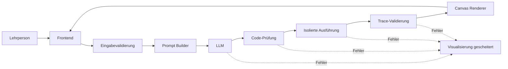

# Architektur und Anforderungen

## Zweck und Umfang

Die Anwendung hilft Lehrenden, den Ablauf eines eigenen Algorithmus anhand von Pseudocode schrittweise zu erklären. Die erste Version verarbeitet Arrays, Graphen und Skalare. Referenzfälle sind Bubble Sort, Insertion Sort, binäre Suche, Breitensuche und Tiefensuche.

Nicht Bestandteil sind Benutzerverwaltung, dauerhafte Speicherung, Videoexport, ein eigenes KI-Modell und Datenstrukturen außerhalb der drei definierten Kategorien.

## Architekturentscheidung

Das Sprachmodell erhält keinen direkten Zugriff auf Canvas oder Browser-APIs. Es erzeugt JavaScript-Code, der ausschließlich ein bereitgestelltes `input`-Objekt und eine dokumentierte `viz`-API nutzt. Diese API zeichnet Visualisierungsaufrufe als Trace auf. Der Canvas-Renderer verarbeitet ausschließlich den validierten Trace.

## Komponenten

| Komponente | Verantwortung |
|---|---|
| Frontend | Pseudocode und Daten erfassen, Eingabeform anzeigen, Wiedergabe steuern |
| Input Resolver | Daten prüfen und ins typisierte `input`-Objekt übertragen |
| Prompt Builder | API-Vertrag, Ausgabeformat, Pseudocode und Eingaben zusammensetzen |
| LLM Gateway | Modellzugriff und strukturierte Antworten verwalten |
| Code-Prüfung | Ausgabeformat und erlaubte Schnittstellen vor Ausführung prüfen |
| Sandbox | Code mit Zeit-, Speicher- und Schrittlimits ausführen |
| Trace Validator | Trace gegen JSON-Schema und Invarianten prüfen |
| Canvas Renderer | Trace darstellen und wiedergeben |

## Datenfluss

1. Die Lehrperson gibt Pseudocode und Daten ein.
2. Die Eingabe wird validiert und als `input` bereitgestellt.
3. Der Prompt Builder ergänzt den festen API- und Ausgabe-Vertrag.
4. Das LLM liefert Code oder bei Unklarheit eine strukturierte Rückfrage.
5. Der Code wird geprüft und isoliert ausgeführt.
6. `viz`-Aufrufe erzeugen Trace-Events mit Pseudocode-Zeile und Erklärung.
7. Der Trace wird validiert und über den Canvas wiedergegeben.

## Visualisierungsvertrag

Die API enthält keine Algorithmuslogik. Vorgesehen sind: `viz.array(id, values)`, `viz.node(id, label, position)`, `viz.edge(id, sourceId, targetId)`, `viz.highlight(id, style)`, `viz.label(id, text)` und `viz.step({ line, explanation })`.

Jeder Schritt referenziert eine Pseudocode-Zeile und enthält einen wiederherstellbaren Darstellungszustand oder die nötige Änderung mit Vorgängerwert.

## Fehlerbehandlung und Sicherheit

Der Verarbeitungslauf wird von einem Fehlerhandler umschlossen. Fehler in Modellantwort, Code-Prüfung, Sandbox, Trace-Validierung oder Renderer zeigen im Frontend **„Visualisierung gescheitert“**; technische Details bleiben für Entwicklung und Debugging verfügbar.

Die Sandbox muss Endlosschleifen extern abbrechen und Netzwerk, Dateisystem, DOM und Geheimnisse sperren. `try/catch` allein genügt nicht, daher gelten auch Ausführungszeit-, Speicher- und Eventlimits.

## Qualitätskriterien

- Trace ist valide und jeder Schritt wiederherstellbar.
- Markierte Pseudocode-Zeile und Visualisierung stimmen überein.
- Rückwärtsnavigation stellt den vorherigen Zustand exakt wieder her.
- Referenzfälle behalten ihre Eingaben und liefern das erwartete Resultat.
- Ungültige Modellantworten und Sandbox-Fehler werden kontrolliert behandelt.
