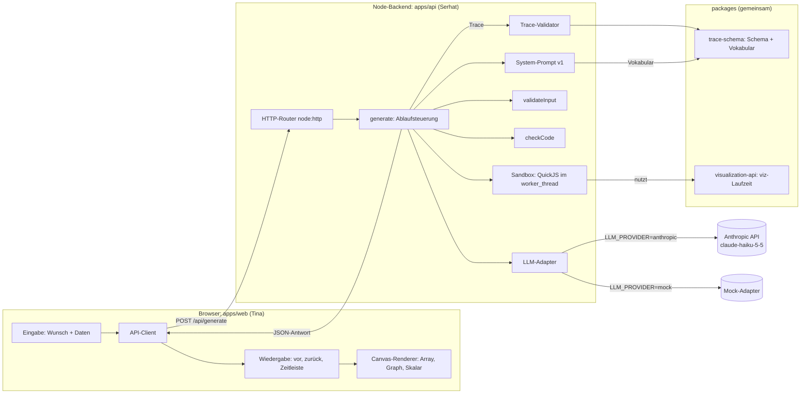
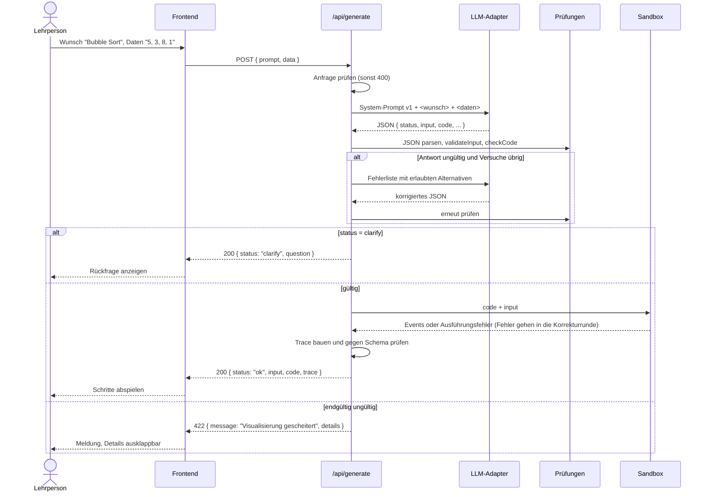
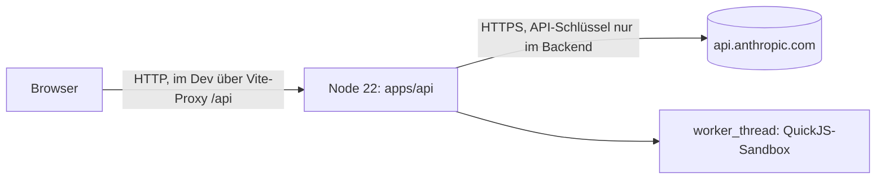

# Architektur-Entwurf, Stand Sprint 3

Stand: 06.11.2026. Entwurf von Serhat zur Abstimmung mit Tina. Ergänzt `architecture.md`, das noch vom Pseudocode-Ansatz und einer älteren viz-API (`viz.node`, `viz.edge`, `viz.label`) ausgeht. Verbindlich für die viz-API bleibt `interface-contract.md`.

## Was sich gegenüber `architecture.md` ändert

| Vorher | Jetzt |
| --- | --- |
| Lehrperson gibt Pseudocode und Daten ein | Lehrperson gibt einen freien Wunsch und optional Daten ein |
| Eingabeform wird vorab gewählt | Das Modell wählt die Form von `input`, das Backend prüft sie |
| `step.line` = Zeile im Pseudocode | `step.line` = Zeile im generierten Code, ermittelt von der Laufzeit (umgesetzt in der Sandbox) |
| `trace.source` = Pseudocode | `trace.source` = generierter Code |
| Fehlerfälle getrennt angezeigt | nach außen immer „Visualisierung gescheitert“, intern getrennte Codes |

Trace-Format, viz-API und Vokabular bleiben unverändert.

## Komponenten



| Komponente | Datei | Verantwortung | Stand |
| --- | --- | --- | --- |
| HTTP-Router | `apps/api/src/app.mjs` | Routen, Größenlimit, Content-Type, Fehlerform | vorhanden (Tina), um `/api/generate` erweitert |
| Ablaufsteuerung | `apps/api/src/generate/generate.mjs` | Anfrage prüfen, Modell rufen, Antwort prüfen, Korrekturrunde | neu |
| System-Prompt | `apps/api/src/llm/systemPrompt.mjs` | Prompt v1, Nutzer- und Korrekturnachricht | neu |
| Antwortschema | `apps/api/src/llm/responseSchema.mjs` | JSON-Schema für Structured Outputs | neu |
| LLM-Adapter | `apps/api/src/llm/adapters/*.mjs` | einheitliche Schnittstelle `complete({ system, messages })` | neu: `anthropic`, `mock` |
| Eingabeprüfung | `apps/api/src/generate/validateInput.mjs` | Formen, Grenzen, Querbezüge, Normalisierung | neu |
| Code-Prüfung | `apps/api/src/generate/checkCode.mjs` | Syntax, verbotene Bezeichner, erlaubte viz-Methoden | neu |
| Sandbox | `apps/api/src/sandbox/sandbox.mjs`, `worker.mjs` | Code isoliert mit Zeit-, Speicher- und Eventlimit ausführen, `step.line` setzen | Prototyp |
| Trace-Validator | `packages/trace-schema` | Trace gegen Schema prüfen | vorhanden |
| viz-Laufzeit | `packages/visualization-api` | Aufrufe aufzeichnen, `prev` ergänzen | vorhanden, `viz.graph` kopiert jetzt die Listen ins Event |

## Ablauf einer Anfrage



## Sandbox (Prototyp, Stand 08.11.)

Umgesetzt nach dem Vorschlag aus `technologieauswahl.md` vom 13.10.:

| Schicht | Was sie leistet |
| --- | --- |
| QuickJS (`quickjs-emscripten` 0.32.0, WebAssembly) | eigene JavaScript-Engine ohne Node-, Netz-, Datei- oder Timer-APIs. Speicherlimit 32 MB, Stack 1 MB, Zeitlimit 2 s über einen Interrupt-Handler. Nur JSON verlässt die Engine. |
| `worker_thread` | eigener Thread ohne Umgebungsvariablen (`env: {}`), damit der API-Schlüssel nicht erreichbar ist. Der Hauptthread beendet ihn hart nach 2 s plus 1,5 s Puffer, falls QuickJS nicht rechtzeitig abbricht. |
| viz-Laufzeit | dieselbe `createViz` wie im Paket, als Skript in QuickJS geladen. Eventlimit 50 000, danach Teilergebnis mit `truncated: true`. |

Weitere Details:

- `input` wird tief eingefroren. Der Code muss auf Kopien arbeiten (so steht es auch im Prompt).
- `viz.step` ist in der Sandbox umhüllt: Es ermittelt die Zeile des Aufrufs aus dem QuickJS-Stack und setzt `step.line`. Ein vom Modell gesetztes `line` wird ignoriert.
- Laufzeitfehler kommen mit Zeile im Modellcode zurück (`Zeile 3: cannot read property 'x' of null`) und gehen so in die Korrekturrunde.
- Pro Anfrage startet ein neuer Worker. Ein Bubble-Sort-Lauf dauert lokal etwa 70 ms inklusive Start.
- Einschränkung: Laut README ist `quickjs-emscripten` nicht auditiert und liegt unter Version 1.0. Für ein Uni-Projekt halte ich die zwei Schichten für angemessen. Für einen echten Betrieb käme eine Prozess- oder Container-Isolation dazu.

`new Function` im Backend dient nur der Syntaxprüfung vor der Sandbox und führt nichts aus. Generierter Code wird nie im HTTP-Prozess ausgeführt.

## Verteilung



Der API-Schlüssel liegt nur als Umgebungsvariable im Backend und erreicht nie den Browser.

## Oberfläche (grobe Skizze)

```
┌───────────────────────────────────────────────────────────────────────┐
│  Algorithmen visualisieren                         Backend: ● mock    │
├───────────────────────────────────────────────────────────────────────┤
│  Was möchtest du sehen?                                               │
│  ┌─────────────────────────────────────────────────────────────────┐  │
│  │ Zeig mir Bubble Sort                                            │  │
│  └─────────────────────────────────────────────────────────────────┘  │
│  Eigene Daten (optional)                                              │
│  ┌──────────────────────────────────────────┐  [ Visualisieren ]      │
│  │ 5, 3, 8, 1                                │                        │
│  └──────────────────────────────────────────┘                        │
├───────────────────────────────────────────────────────────────────────┤
│  Bubble Sort · Eingabe: deine Daten                                   │
│                                                                       │
│        ┌───┐ ┌───┐ ┌───┐ ┌───┐                                         │
│        │ 3 │ │ 5 │ │ 8 │ │ 1 │      Schritt 4 von 23                   │
│        └───┘ └───┘ └───┘ └───┘                                         │
│              ▲     ▲                                                  │
│              compare                                                  │
│                                                                       │
│  „5 ≤ 8, kein Tausch.“                                                │
│                                                                       │
│  [ |◀ ]  [ ◀ ]  [ ▶ ]  [ ▶| ]   ───────●───────────────  Zeitleiste   │
├───────────────────────────────────────────────────────────────────────┤
│  ▸ Generierter Code anzeigen        ▸ Technische Details              │
└───────────────────────────────────────────────────────────────────────┘
```

Zustände der Ergebnisfläche: leer, lädt, Rückfrage (Text der Frage plus Hinweis, den Wunsch zu ergänzen), Ergebnis (wie oben), Fehler („Visualisierung gescheitert“, darunter ausklappbar `details`). Der Hinweis „Beispieldaten“ erscheint, wenn `inputSource` `example` ist. Die Ausgestaltung liegt bei Tina.

## Offene Punkte zur Abstimmung

1. `interface-contract.md` Abschnitt 2 und 4 an die neue Bedeutung von `step.line` und `trace.source` anpassen.
2. Sandbox-Prototyp im Team bestätigen (QuickJS im Worker).
3. Graph-Rendering im Frontend; bisher werden vor allem Arrays dargestellt.
4. Ob `scalar` im Renderer eine eigene Darstellung bekommt.
5. API-Schlüssel beim Betreuer anfragen, sonst bleibt nur der Mock.
6. `architecture.md` durch dieses Dokument ersetzen oder beide zusammenführen.
